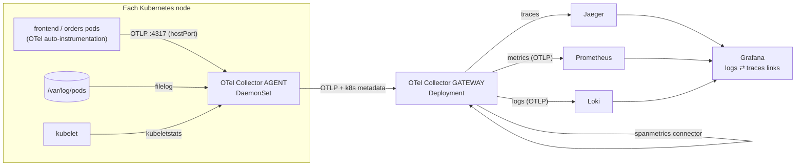

# OpenTelemetry Collector on Kubernetes

[](https://github.com/sumitgupta477/otel-k8s-observability/actions/workflows/e2e.yml)

A complete, reproducible observability stack: one vendor-neutral **OpenTelemetry Collector** pipeline that carries **traces, metrics and logs** from Kubernetes workloads to **Jaeger, Prometheus and Loki**, viewed together in **Grafana** with one-click links between a log line and its trace.

Everything runs on a local 3-node [kind](https://kind.sigs.k8s.io/) cluster with one command, and a GitHub Actions workflow builds it from scratch and verifies the whole flow end to end on every push.

## Architecture



| Layer | What it does | Where |
|---|---|---|
| **Apps** | Two Python services (frontend → orders) with zero-code auto-instrumentation. All OTel settings are environment variables, nothing hard-coded | [`app/`](app/), [`k8s/demo/`](k8s/demo/) |
| **Agent** (DaemonSet) | One collector per node: receives OTLP from local pods, tails container log files, scrapes kubelet and host metrics, adds Kubernetes metadata, forwards to the gateway | [`helm/otel-agent-values.yaml`](helm/otel-agent-values.yaml) |
| **Gateway** (Deployment) | Central processing: memory limits, batching, scrubbing sensitive attributes, RED metrics from traces, fan-out to the backends | [`helm/otel-gateway-values.yaml`](helm/otel-gateway-values.yaml) |
| **Backends** | Jaeger (traces), Prometheus 3 and Loki 3 (both ingest OTLP natively), Grafana with provisioned data sources and a dashboard | [`k8s/backends/`](k8s/backends/) |

## What it demonstrates

- **Agent + gateway collector pattern**, both installed with the official Helm chart, using the chart's presets for log collection, Kubernetes metadata, kubelet metrics and host metrics.
- **Collector pipelines**: receivers, processors (`memory_limiter`, `batch`, `k8sattributes`, attribute scrubbing), exporters, and a **connector** (`spanmetrics`) that turns traces into request-rate, error-rate and latency metrics.
- **Distributed tracing** across two services through W3C `traceparent` propagation, plus a manual span for the database step.
- **Log ↔ trace correlation**: every log line carries `trace_id`, and Grafana links Loki lines to Jaeger traces and back.
- **Swappable backends**: apps and agents only speak OTLP to the collector. Moving from Jaeger to Tempo, X-Ray or Datadog, or from Prometheus to another metrics store, is a change to the gateway's exporters only.
- **Kustomize** for the backends and apps (including generated ConfigMaps for Grafana), **Helm** for the collectors.
- **Tested end to end in CI**: [`.github/workflows/e2e.yml`](.github/workflows/e2e.yml) creates the cluster, deploys everything and runs [`scripts/smoke_test.py`](scripts/smoke_test.py).

## Run it locally

Requirements: Docker, [kind](https://kind.sigs.k8s.io/), kubectl, Helm 3, Python 3.

```bash
scripts/up.sh          # creates the kind cluster and deploys everything (~5 min)
scripts/smoke_test.sh  # verifies traces, metrics, logs and log-to-trace links
```

Then open the UIs:

```bash
kubectl -n observability port-forward svc/grafana 3000:3000      # http://localhost:3000
kubectl -n observability port-forward svc/jaeger 16686:16686     # http://localhost:16686
```

A load generator sends a request every second, so data is always flowing. In Grafana:
- **Dashboards → OpenTelemetry demo → RED metrics**: request rate, error rate, p95 latency per service (from traces), orders per second (app metric), and pod CPU (from the node agents).
- **Explore → Loki**, query `{k8s_namespace_name="demo"}`, expand a line and click **TraceID** to open the trace in Jaeger. From a trace, **Logs for this span** jumps back to Loki.

Tear down with `scripts/down.sh`.

## The end-to-end test

`scripts/smoke_test.py` passes only if all of these hold:

1. Jaeger has a trace spanning **both** services, including the `db.insert_order` span.
2. Prometheus has the app's business metric (`orders_created_total`).
3. Prometheus has RED metrics generated by the gateway's `spanmetrics` connector.
4. Prometheus has kubelet pod metrics collected by the node agents.
5. Loki has demo pod logs with Kubernetes labels and a `trace_id`.
6. A `trace_id` taken from a Loki log line resolves to a trace in Jaeger.

## Design notes

- **Why an agent and a gateway?** The agent stays small and node-local (log files, kubelet, hostPort for apps). The gateway holds the logic that should be configured once: sampling, scrubbing, derived metrics and backend credentials. Agents keep working if a backend changes.
- **Why apps send to the node agent, not the gateway?** Lower latency, no cross-node traffic for every span, and the agent can attach node metadata. Pods find their agent through the downward API (`status.hostIP`).
- **Why pod identity in `OTEL_RESOURCE_ATTRIBUTES`?** Traffic through a hostPort can arrive with a translated source IP, which breaks the `k8sattributes` processor's default IP-based lookup. Sending `k8s.pod.uid` lets it match the pod reliably.
- **Logs via stdout and filelog, not OTLP**: the same path works for every container, including ones you can't instrument. That's how Fluent Bit or Filebeat DaemonSets usually do it, now handled by the same collector.
- **Demo shortcuts**: kubelet TLS verification is skipped because kind's kubelet certificates have no IP SANs; in-memory Jaeger, `emptyDir` storage for Prometheus and Loki, anonymous Grafana admin. For production use persistent storage, authentication, TLS between collectors and backends, and tail-based sampling in the gateway.

## Versions

Pinned for reproducibility: OpenTelemetry Collector Helm chart 0.178.2, Jaeger 2.23.0, Prometheus 3.16.0, Loki 3.7.9, Grafana 13.3.0, OpenTelemetry Python 1.45.2 / 0.66b2.
